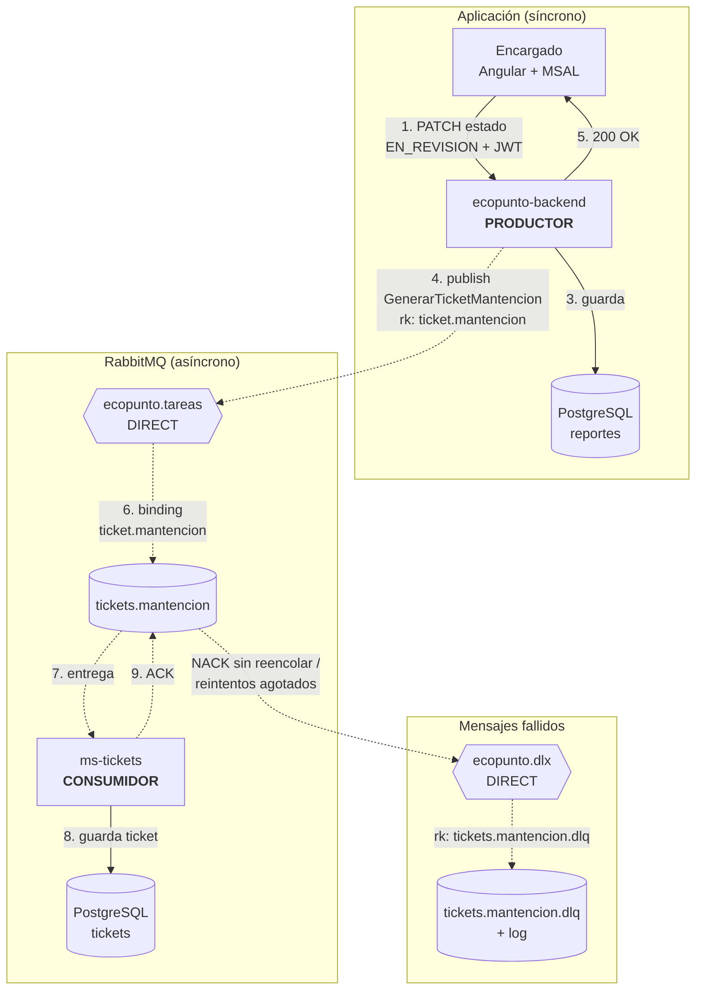

# Diseño de integración asíncrona con RabbitMQ · EcoPunto

**Asignatura:** DSY1107 · Desarrollo Cloud Native I · Sección 002D  
**Estudiante:** Jonathan Larraguibel (trabajo individual)  
**Actividad:** Diseño de integración asíncrona · 10% de la EV2  
**Funcionalidad:** generación del ticket de mantención al pasar un reporte a revisión

## 1. Funcionalidad y contexto

EcoPunto permite a los vecinos reportar problemas en puntos limpios de reciclaje ("el contenedor de vidrio fue retirado", "el buzón de pilas está lleno"). El **encargado** del punto revisa cada reporte y, cuando lo acepta como válido, lo cambia de `PENDIENTE` a `EN_REVISION`.

**Qué hace la funcionalidad.** Cuando un reporte pasa a `EN_REVISION`, el sistema genera un **ticket de mantención**: un documento con número correlativo, punto limpio, dirección, comuna, problema reportado, prioridad y fecha, que el equipo de terreno usa para ir a resolverlo.

**Problema que resuelve.** Hoy el cambio de estado no tiene consecuencia operativa: alguien tiene que copiar a mano los datos del reporte para coordinar la visita. El ticket formaliza esa orden de trabajo y deja trazabilidad.

**Componentes que participan.**

| Componente | Rol |
|---|---|
| Frontend Angular + MSAL | El encargado presiona "Pasar a revisión" |
| `ecopunto-backend` (Spring Boot, existente) | Cambia el estado del reporte y **publica** la tarea |
| RabbitMQ | Recibe, enruta y guarda el mensaje |
| `ms-tickets` (Spring Boot, nuevo) | **Consume** la tarea, genera el ticket y lo guarda en su propia base de datos |

**Por qué conviene procesarla de forma asíncrona.** Para el encargado lo importante es que el reporte quedó en revisión; eso debe responderse de inmediato. Generar el ticket es una **consecuencia** que puede tardar (armar el documento, asignar correlativo, a futuro generar un PDF o avisar a una empresa externa) y puede fallar sin que eso deba deshacer el cambio de estado.

## 2. Justificación arquitectónica

| Aspecto | HTTP/REST síncrono (backend → ms-tickets) | RabbitMQ |
|---|---|---|
| Acoplamiento | El backend necesita la URL de ms-tickets y que esté arriba | El backend solo conoce el exchange; no sabe quién genera el ticket |
| Tiempo de respuesta | El encargado espera a que el ticket se genere | Responde apenas se guarda el estado y se publica el mensaje (milisegundos) |
| Tolerancia a fallos | Si ms-tickets está caído, el cambio de estado falla o queda sin ticket | El mensaje espera en una cola durable hasta que ms-tickets vuelva |
| Reintentos | Habría que programarlos en el backend | Reintentos y DLQ los maneja la infraestructura de mensajería |
| Picos de carga | Muchas revisiones juntas saturan ms-tickets | La cola absorbe el pico; ms-tickets procesa a su ritmo y puede escalar con más instancias |

**Por qué un exchange `direct`.** El mensaje es una **tarea** ("genera un ticket para este reporte"), no un aviso general: tiene un único tipo de trabajador y la routing key debe calzar exactamente. No se usa `fanout` porque no se busca difundir a todos, ni `topic` porque no se necesitan patrones. Si se agregan más instancias de ms-tickets, todas leen la **misma cola** y RabbitMQ reparte las tareas entre ellas (*work queue*).

Lo que **no** se hace asíncrono: el cambio de estado del reporte. Es la operación principal y el encargado necesita saber si se aplicó.

## 3. Diagrama de la solución



Líneas continuas: llamadas síncronas y acceso a datos. Líneas punteadas: mensajería. Los números corresponden al paso a paso de la sección 4.

## 4. Componentes de RabbitMQ y descripción del flujo

| Elemento | Definición |
|---|---|
| **Función gatillante** | El encargado cambia un reporte a `EN_REVISION` (`PATCH /api/reportes/{id}/estado`, rol `ENCARGADO`) |
| **Productor** | `ecopunto-backend`, mediante un `TareaPublisher` en su capa de mensajería |
| **Mensaje** | `GenerarTicketMantencion` en JSON, persistente (`delivery_mode: 2`) |
| **Exchange** | `ecopunto.tareas`, tipo `direct`, durable |
| **Enrutamiento** | Routing key `ticket.mantencion`; binding `ecopunto.tareas → tickets.mantencion` con la misma key |
| **Cola** | `tickets.mantencion`, durable, con `x-dead-letter-exchange: ecopunto.dlx` y `x-dead-letter-routing-key: tickets.mantencion.dlq` |
| **Consumidor** | `ms-tickets`, un `@RabbitListener` con ACK **manual**, que crea el ticket |
| **Resultado** | Ticket guardado (`TK-000123`, estado `ABIERTO`), visible en `GET /api/tickets`; ACK a RabbitMQ |

Estructura del mensaje:

```json
{
  "messageId": "b7f1c2e4-…",
  "tipo": "GenerarTicketMantencion",
  "ocurridoEn": "2026-10-17T15:20:00Z",
  "reporteId": 42,
  "puntoLimpioId": 1,
  "puntoNombre": "Punto Limpio Ñuñoa",
  "direccion": "Av. Irarrázaval 3000",
  "comuna": "Ñuñoa",
  "descripcion": "El contenedor de vidrio fue retirado",
  "solicitadoPor": "encargado@ecopunto.cl"
}
```

El mensaje lleva los datos del punto para que ms-tickets **no tenga que consultar al backend** y así no volver a acoplarlos.

**Paso a paso**

1. El encargado presiona "Pasar a revisión". Angular envía `PATCH /api/reportes/42/estado` con su JWT, a través del API Gateway.
2. El backend valida el token y el rol `ENCARGADO`, y verifica que la transición `PENDIENTE → EN_REVISION` sea válida.
3. Guarda el nuevo estado en PostgreSQL.
4. **Después del commit** de esa transacción, publica `GenerarTicketMantencion` en `ecopunto.tareas` con routing key `ticket.mantencion`. Publicar después del commit evita generar tickets de cambios que se revirtieron.
5. Responde `200 OK` al encargado, sin esperar el ticket.
6. El exchange `direct` compara la routing key con sus bindings y deja el mensaje en `tickets.mantencion`.
7. RabbitMQ entrega el mensaje a ms-tickets. Mientras no haya ACK, el mensaje queda como *unacked* y no se pierde.
8. ms-tickets verifica que no exista ya un ticket para ese `reporteId`, genera el ticket y lo guarda.
9. Solo después de guardar, envía `basicAck`; RabbitMQ elimina el mensaje de la cola.
10. El ticket queda disponible en `GET /api/tickets` y en la vista "Tickets" del frontend.

## 5. Manejo de situaciones excepcionales

**Si el consumidor no está disponible.** La cola es durable y el mensaje persistente: queda en `tickets.mantencion` (estado *Ready*) hasta que ms-tickets vuelva y lo procese. Si ms-tickets se cae **mientras** procesa un mensaje sin haber enviado el ACK, RabbitMQ lo devuelve a la cola y lo entrega de nuevo.

**Si el procesamiento falla**, se distingue el tipo de error:

| Tipo de error | Ejemplo | Acción |
|---|---|---|
| Recuperable | La base de datos de tickets no responde | Reintentar hasta 3 veces con espera creciente (1 s, 2 s, 4 s); si sigue fallando, a la DLQ |
| No recuperable | JSON inválido, `reporteId` nulo | `basicNack(requeue=false)`: va directo a la DLQ, porque reintentar no lo arreglaría |

Los mensajes que llegan a `tickets.mantencion.dlq` quedan **registrados en el log** con su motivo y se pueden revisar en el Management UI para reprocesarlos manualmente cuando se corrija el problema. Así un mensaje defectuoso no bloquea la cola ni se pierde.

**Cómo evitar perder mensajes**

- Exchange y cola **durables**; mensaje **persistente**.
- **Publisher confirms**: el backend registra un error si RabbitMQ no confirma la recepción del mensaje.
- ACK **manual y al final**: el consumidor confirma solo después de guardar el ticket.

**Cómo evitar procesar dos veces la misma operación.** RabbitMQ garantiza entrega *al menos una vez*, así que un mensaje puede llegar repetido (por ejemplo, si el consumidor guardó el ticket pero se cayó antes del ACK). ms-tickets es **idempotente**: la tabla de tickets tiene una restricción única sobre `reporteId`. Si el ticket ya existe, no crea otro, registra "mensaje duplicado" en el log y envía ACK igual.
