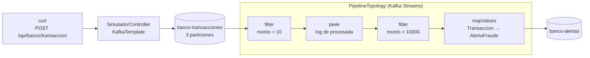

# Laboratorio 3.2.2 · Pipeline de eventos del caso end-to-end

**Asignatura:** DSY1107 · Desarrollo Cloud Native I
**Actividad:** 3.2.2 · Pipeline de eventos del caso end-to-end
**Modalidad:** individual · **Entrega:** repositorio GitHub

## 1. Integrantes

- Jonathan Larraguibel

## 2. Objetivo

Construir con Kafka Streams un pipeline de monitoreo de transacciones bancarias:

- Recibir transacciones en el topic `banco-transacciones`.
- Filtrar las transacciones de monto bajo.
- Detectar montos sobre 10.000 y generar una alerta.
- Publicar las alertas en el topic `banco-alertas`.

## 3. Arquitectura



La topología es *stateless*: cada evento se evalúa por sí solo, sin guardar estado. La key es el usuario, así que las transacciones de un mismo usuario quedan en orden dentro de su partición.

## 4. Requisitos

- Docker Desktop (Docker Compose v2)
- JDK 17 o superior (probado con OpenJDK 21)
- Maven 3.9+
- `curl`

## 5. Cómo ejecutar

```bash
docker compose up -d
```

Crear el topic de entrada **antes** de levantar la aplicación:

```bash
docker exec kafka-banco-pipeline-kafka-1 kafka-topics --bootstrap-server localhost:9092 --create --topic banco-transacciones --partitions 3 --replication-factor 1
```

```bash
mvn spring-boot:run
```

Transacción normal (se procesa, sin alerta):

```bash
curl -X POST http://localhost:8081/api/banco/transaccion -H "Content-Type: application/json" -d '{"usuario": "juan", "monto": 500, "origen": "app"}'
```

Transacción sospechosa (genera alerta):

```bash
curl -X POST http://localhost:8081/api/banco/transaccion -H "Content-Type: application/json" -d '{"usuario": "juan", "monto": 15000, "origen": "cajero"}'
```

Transacción ignorada (la descarta el filtro):

```bash
curl -X POST http://localhost:8081/api/banco/transaccion -H "Content-Type: application/json" -d '{"usuario": "juan", "monto": 5, "origen": "app"}'
```

Kafka UI queda en http://localhost:8080. Para apagar todo:

```bash
docker compose down
```

## 6. Resultados

| Monto | Consola | `banco-alertas` |
|---|---|---|
| 500 | `Transacción procesada: 500.0` | Sin mensaje |
| 15000 | `Transacción procesada: 15000.0` y `ALERTA GENERADA` | 1 alerta, severidad ALTA |
| 5 | Nada | Sin mensaje |

El detalle, las salidas y las capturas están en [docs/evidencias.md](docs/evidencias.md).

## 7. Diferencias con la guía

El código se copió primero tal como está en la guía y se corrigió solo lo que impidió ejecutarlo:

| # | Problema al seguir la guía | Error real | Corrección |
|---|---|---|---|
| 1 | No se activa Kafka Streams | `required a bean of type 'StreamsBuilder'` | `@EnableKafkaStreams` en `PipelineTopology` |
| 2 | La aplicación y Kafka UI usan el puerto 8080 | `Port 8080 was already in use` | `server.port: 8081`; los `curl` apuntan a ese puerto |
| 3 | El topic de entrada no existe al arrancar. La auto-creación del broker no alcanza, porque Streams no la gatilla | `MissingSourceTopicException` y el stream queda en estado `ERROR` | Crear `banco-transacciones` antes de levantar la aplicación |
| 4 | El productor no tiene serializador JSON | `Can't convert value of class com.banco.model.Transaccion` | `value-serializer: JsonSerializer` en `application.yml` |

Además:

- `application.yml` aparece en la guía sin la raíz `spring:`; se reconstruyó bajo esa clave.
- La guía no indica el `parent`, así que se usó el mismo del lab 3.2.1 (Spring Boot 3.2.0).

## 8. Alcance real

El contexto de la guía promete más de lo que implementa su código. Se respetó el código de la guía, así que esto **no** está implementado:

| El contexto dice | Estado |
|---|---|
| Convertir moneda a USD | No implementado; la guía no incluye código |
| Calcular el total gastado por usuario | No implementado; requeriría `groupByKey` y `aggregate` con estado |
| Salida en el topic `alertas-fraude` | El código usa `banco-alertas` |
| Ignorar montos menores a 10 | El filtro es `monto > 10`, así que un monto de exactamente 10 también se ignora |

Tampoco hay manejo de errores: un `monto` nulo lanzaría una excepción dentro del filtro y este caso no se probó.

## 9. Conclusiones

- Kafka Streams es una librería dentro de la aplicación, no un servidor aparte. Lee de un topic, transforma y escribe en otro.
- Un filtro no borra nada: la transacción de monto 5 sigue en `banco-transacciones`. Solo no avanza por el pipeline.
- `application-id` funciona como consumer group, por eso `banco-pipeline-app` aparece en Kafka UI con su lag.
