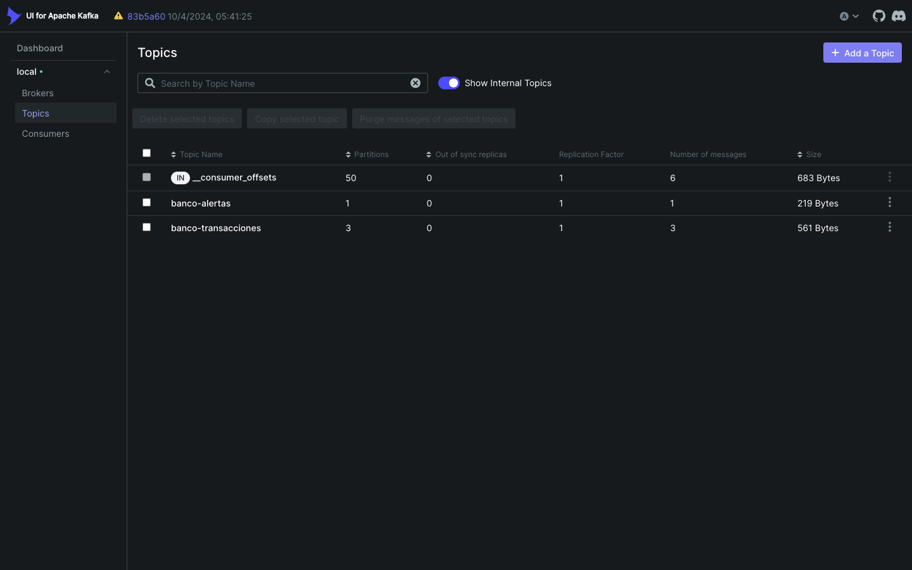
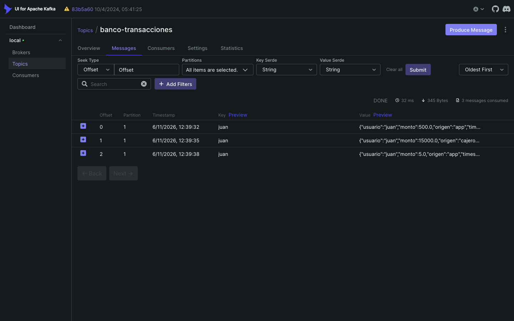
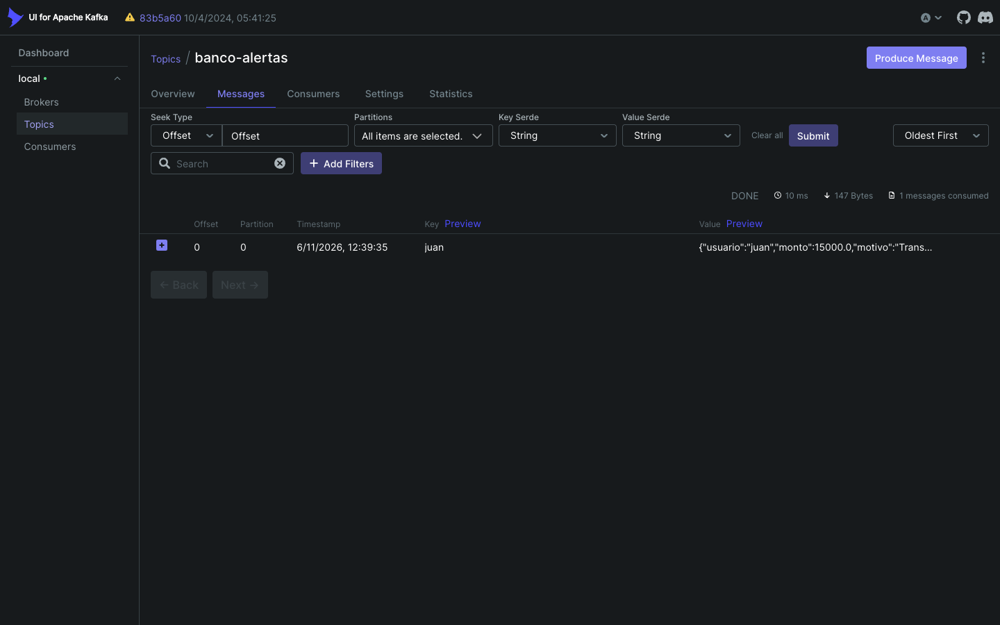
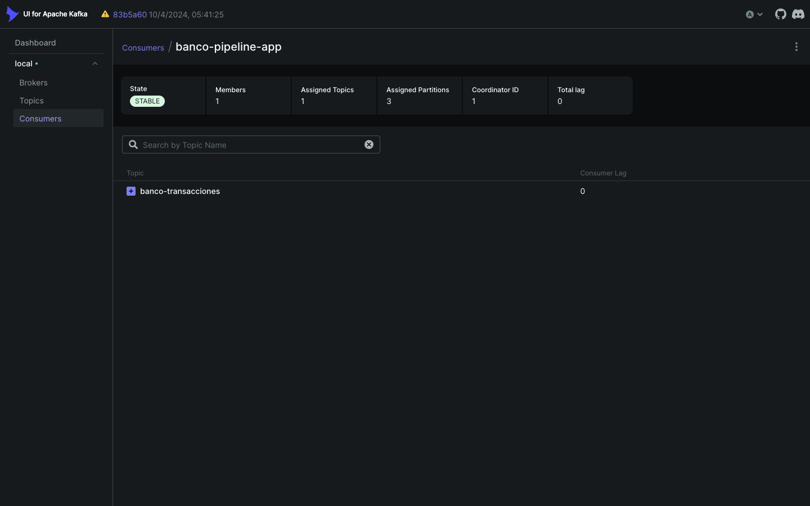

# Evidencias · Laboratorio 3.2.2

Todas las salidas son de ejecuciones reales y están completas en [`salidas/`](salidas/).

## 1. Errores al ejecutar la guía tal como está escrita

| Orden | Archivo | Error |
|---|---|---|
| 1 | [`00-error-1-streamsbuilder.txt`](salidas/00-error-1-streamsbuilder.txt) | Falta el bean `StreamsBuilder` |
| 2 | [`00-error-2-puerto.txt`](salidas/00-error-2-puerto.txt) | Puerto 8080 ocupado por Kafka UI |
| 3 | [`00-error-3-topic-fuente.txt`](salidas/00-error-3-topic-fuente.txt) | Topic de entrada inexistente; Streams pasa a `ERROR` |
| 4 | [`00-error-4-serializer.txt`](salidas/00-error-4-serializer.txt) | El productor no puede serializar `Transaccion` |

Las correcciones están en la sección 7 del [README](../README.md). Después de aplicarlas se recreó el entorno y se repitieron las pruebas desde cero.

## 2. Topic de entrada

`banco-transacciones` con 3 particiones: [`01-topic.txt`](salidas/01-topic.txt).



`banco-alertas` lo creó el broker automáticamente con la primera alerta, por eso tiene 1 partición.

## 3. Pruebas end-to-end

Respuestas en [`02-pruebas-respuestas.txt`](salidas/02-pruebas-respuestas.txt). Consola de la aplicación en [`02-pruebas-consola.txt`](salidas/02-pruebas-consola.txt):

```text
✅ Transacción procesada: 500.0
✅ Transacción procesada: 15000.0
🚨 ALERTA GENERADA: Transacción inusualmente alta en cajero
```

La transacción de monto 5 no aparece en la consola porque la descartó el filtro.

## 4. Contenido de los topics

Salida completa en [`03-topics-contenido.txt`](salidas/03-topics-contenido.txt).

`banco-transacciones` guarda las 3 transacciones, incluida la filtrada. Las 3 están en la misma partición porque comparten la key `juan`:



`banco-alertas` tiene solo la alerta de 15000:

```json
{"usuario":"juan","monto":15000.0,"motivo":"Transacción inusualmente alta en cajero","severidad":"ALTA"}
```



## 5. Consumer group de Streams

`banco-pipeline-app` aparece estable, con 3 particiones asignadas y lag 0:


