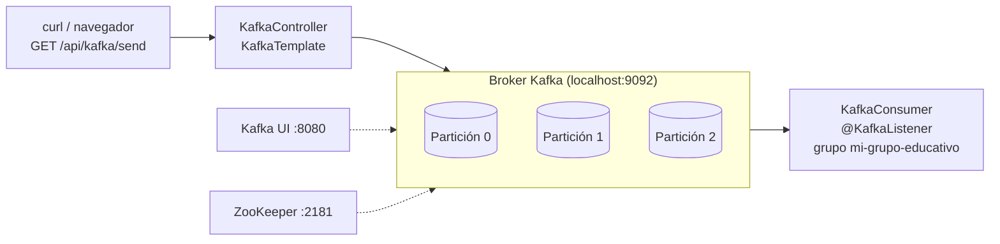

# Laboratorio 3.2.1 · Crear topic, productor y consumidor; offsets y particiones

**Asignatura:** DSY1107 · Desarrollo Cloud Native I
**Actividad:** 3.2.1 · Crear topic, productor y consumidor; offsets y particiones
**Modalidad:** individual · **Entrega:** repositorio GitHub

## 1. Integrantes

- Jonathan Larraguibel

## 2. Objetivo

Construir un primer flujo con Apache Kafka y observar cómo se reparten y se numeran los mensajes:

- Levantar ZooKeeper, un broker Kafka y Kafka UI con Docker Compose.
- Crear el topic `tutorial-particiones` con 3 particiones.
- Implementar un productor (`KafkaTemplate`) y un consumidor (`@KafkaListener`) con Spring Boot.
- Comparar el envío sin key y con key.
- Comprobar que el consumer group recuerda sus offsets después de reiniciar la aplicación.

## 3. Arquitectura



Productor y consumidor viven en la misma aplicación (`:8888`), pero solo se comunican a través del broker.

## 4. Requisitos

- Docker Desktop (Docker Compose v2)
- JDK 17 o superior (probado con OpenJDK 21)
- Maven 3.9+
- `curl`

## 5. Cómo ejecutar

```bash
docker compose up -d
```

Crear el topic. La guía lo hace desde Kafka UI (**Topics → Add a Topic**); aquí se creó por consola con los mismos valores:

```bash
docker exec kafka-tutorial-proyecto-kafka-1 kafka-topics --bootstrap-server localhost:9092 --create --topic tutorial-particiones --partitions 3 --replication-factor 1
```

Levantar la aplicación:

```bash
mvn spring-boot:run
```

Enviar mensajes:

```bash
curl 'http://localhost:8888/api/kafka/send?message=Mensaje1'
```

```bash
curl 'http://localhost:8888/api/kafka/send?message=Paso1-Creada&key=orden-555'
```

Kafka UI queda en http://localhost:8080. Para apagar todo:

```bash
docker compose down
```

## 6. Resultados

| Prueba | Resultado |
|---|---|
| Sin key (3 mensajes) | Los 3 en la partición 1, offsets 0, 1, 2 |
| Con key `orden-555` (3 mensajes) | Los 3 en la partición 2, offsets 0, 1, 2 |
| Reinicio de la aplicación | Solo se leyó el mensaje nuevo (partición 2, offset 3); los 6 anteriores no se repitieron |

El detalle, las salidas y las capturas están en [docs/evidencias.md](docs/evidencias.md).

## 7. Diferencias con la guía

La guía se siguió tal como está escrita. Estos puntos no coincidieron con la ejecución real:

| Punto | La guía dice | Lo que ocurrió | Qué se hizo |
|---|---|---|---|
| Listener sin key | `@Header(KafkaHeaders.RECEIVED_KEY) String key` | Un mensaje sin key no trae ese header y falla con `Missing header 'kafka_receivedMessageKey'`. El mensaje se reintenta y luego se descarta | Se agregó `required = false` |
| Envío sin key | Round robin: un mensaje a cada partición (P0, P1, P2) | Los 3 mensajes cayeron en la misma partición | Se mantuvo el código. Desde Kafka 2.4 el productor usa el *sticky partitioner*: llena un lote en una partición antes de cambiar a otra |
| Nombre "Sticky Partitioning" | Lo usa para el envío con key | Con key el reparto es por hash de la key. *Sticky* es el comportamiento sin key | Se documenta con el nombre correcto |
| Offsets de la prueba 2 | Partición 1, offsets 1, 2, 3 | Partición 2, offsets 0, 1, 2 | Es esperable: la partición depende del hash de la key y de lo que ya tenga esa partición |
| `application.yml` | Aparece sin la indentación completa | Se reconstruyó bajo `spring:` | Mismos valores de la guía |
| `version: '3.8'` | Incluida en el compose | Docker Compose v2 avisa que el atributo está obsoleto | Se dejó igual; es solo una advertencia |

## 8. Conclusiones

- La key decide la partición, y el orden solo está garantizado dentro de una partición. Por eso los eventos de una misma orden deben compartir key.
- El offset es por partición: cada una parte de 0 y avanza por separado.
- Kafka no borra un mensaje al leerlo. El grupo guarda hasta dónde llegó, y por eso un reinicio continúa donde quedó.
- `auto-offset-reset: earliest` solo aplica cuando el grupo no tiene un offset confirmado.
