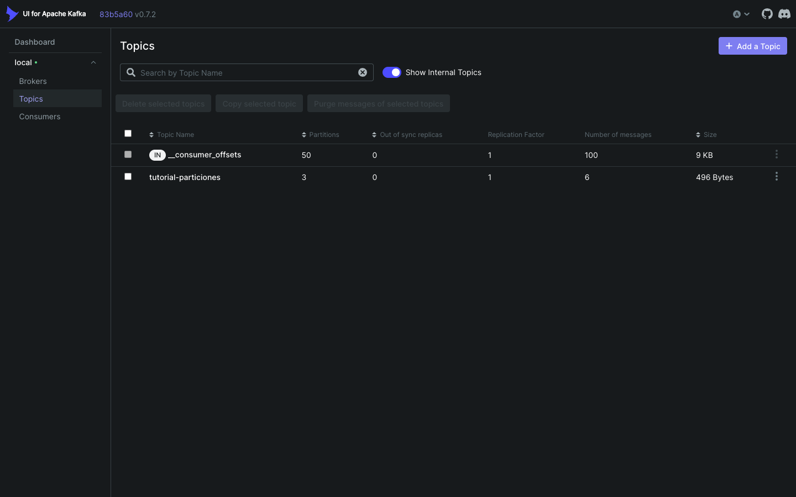
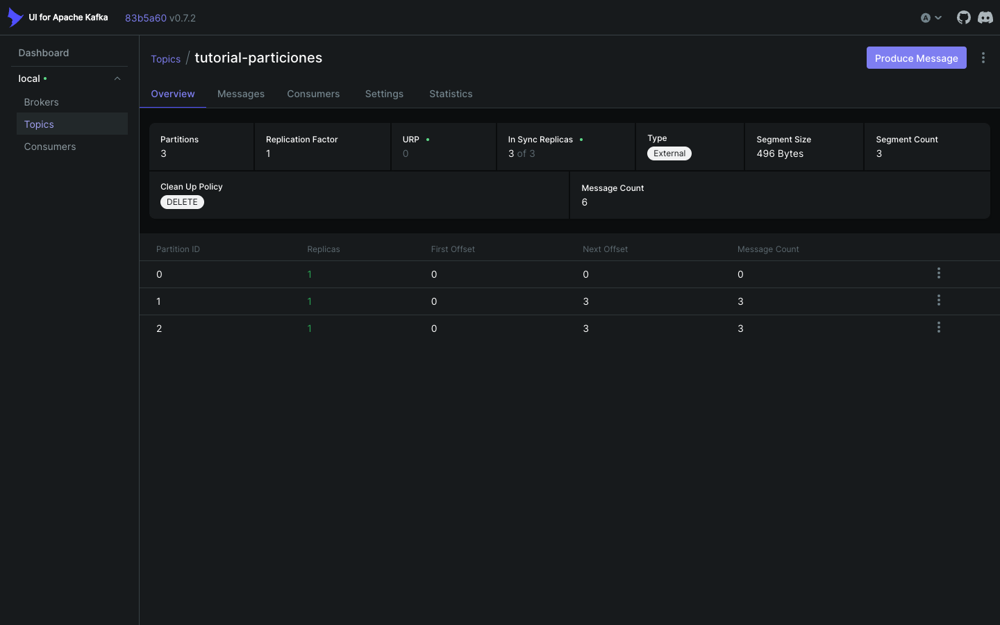
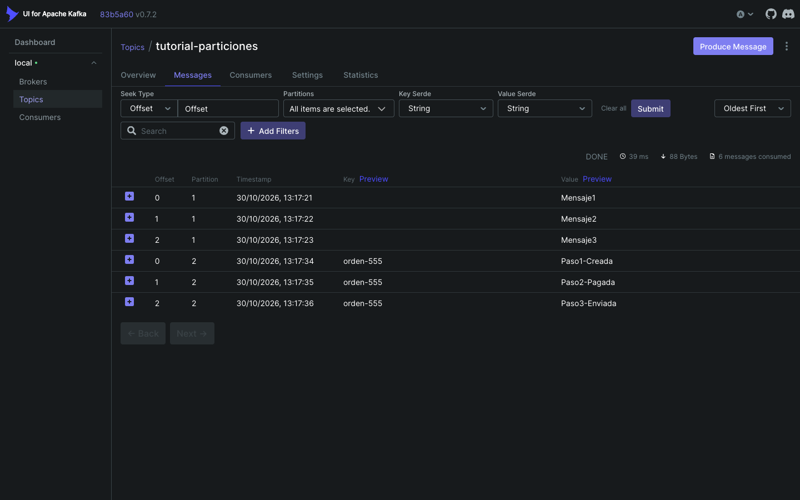
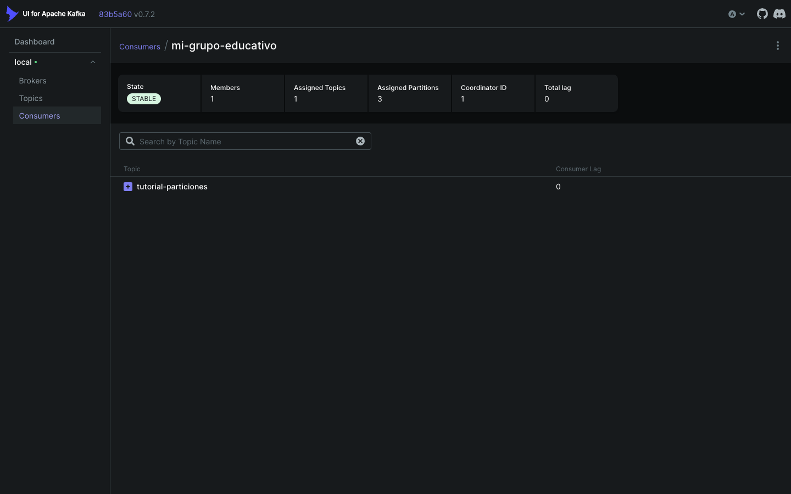

# Evidencias · Laboratorio 3.2.1

Todas las salidas son de ejecuciones reales y están completas en [`salidas/`](salidas/).

## 1. Topic

`tutorial-particiones` con 3 particiones y factor de replicación 1: [`01-topic.txt`](salidas/01-topic.txt).

## 2. Error de la guía: mensaje sin key

Con el listener tal como aparece en la guía, los mensajes sin key fallaron con `Missing header 'kafka_receivedMessageKey'`: [`00-error-guia-header-key.txt`](salidas/00-error-guia-header-key.txt).

Se corrigió con `required = false`. Luego se eliminó y se recreó el topic para repetir la prueba desde cero.

## 3. Prueba 1 · Sin key

| Mensaje | Partición | Offset |
|---|---|---|
| Mensaje1 | 1 | 0 |
| Mensaje2 | 1 | 1 |
| Mensaje3 | 1 | 2 |

Salidas: [`02-prueba1-respuestas.txt`](salidas/02-prueba1-respuestas.txt) y [`02-prueba1-consola.txt`](salidas/02-prueba1-consola.txt).

La guía espera un mensaje por partición. No ocurrió porque el productor usa el *sticky partitioner*, no round robin.

## 4. Prueba 2 · Con key `orden-555`

| Mensaje | Partición | Offset |
|---|---|---|
| Paso1-Creada | 2 | 0 |
| Paso2-Pagada | 2 | 1 |
| Paso3-Enviada | 2 | 2 |

Salidas: [`03-prueba2-respuestas.txt`](salidas/03-prueba2-respuestas.txt) y [`03-prueba2-consola.txt`](salidas/03-prueba2-consola.txt).

## 5. Monitoreo en Kafka UI

La pestaña Messages muestra los 6 mensajes con su partición, offset y key:

El grupo `mi-grupo-educativo` aparece estable, con 3 particiones asignadas y lag 0:

## 6. Persistencia de offsets

Prueba completa en [`04-reinicio-offsets.txt`](salidas/04-reinicio-offsets.txt):

1. Se detuvo la aplicación. El grupo quedó con offset 3 en las particiones 1 y 2.
2. Con la aplicación abajo se publicó `Mensaje-con-app-abajo` con key `orden-777`. Cayó en la partición 2 y el lag subió a 1.
3. Al reiniciar, la aplicación leyó solo ese mensaje (partición 2, offset 3). Los 6 anteriores no se repitieron.
4. El grupo terminó con offset 4 en la partición 2 y lag 0.
